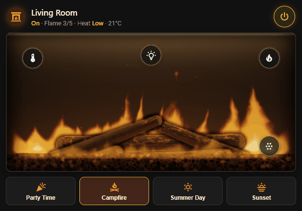
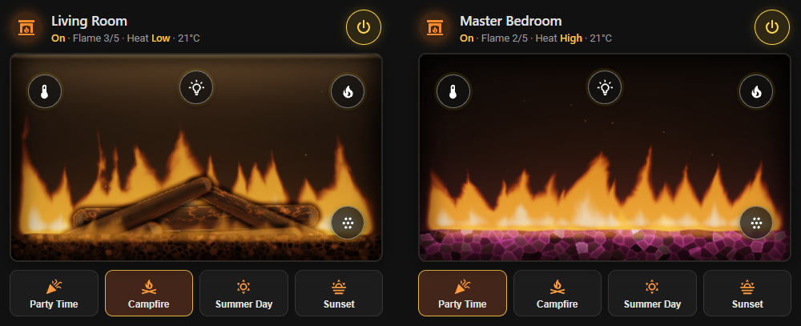
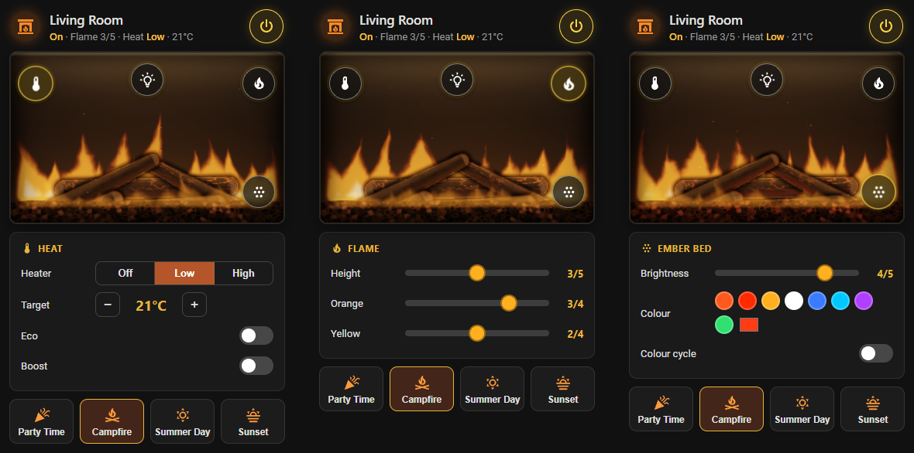
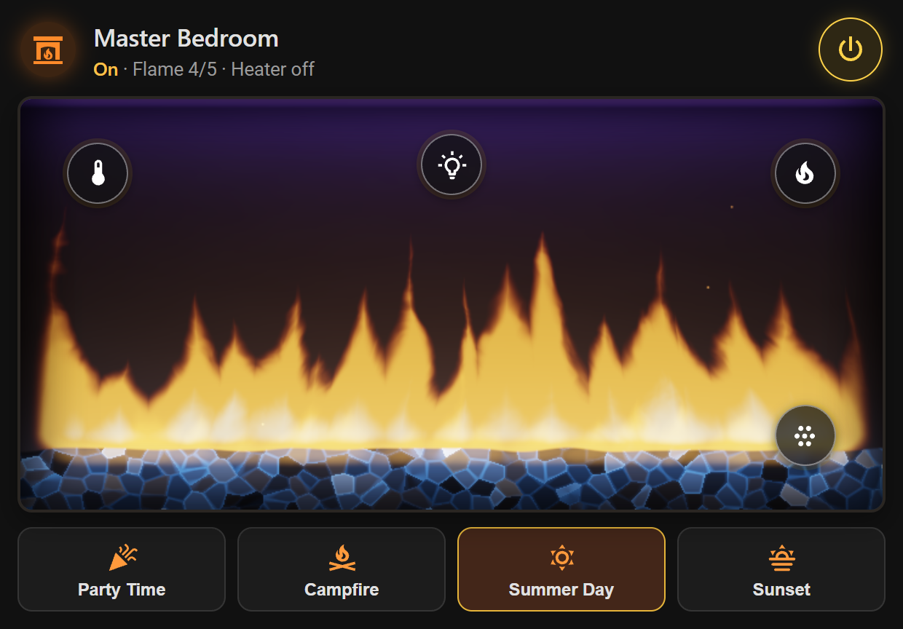
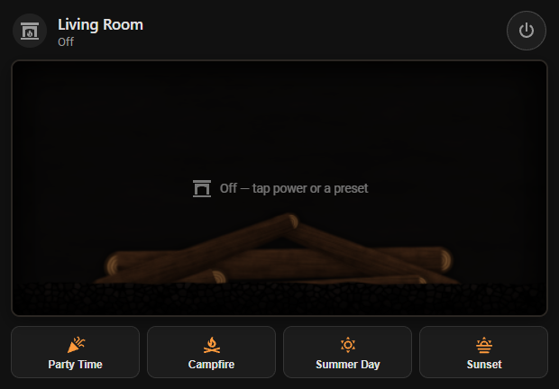

<h1 align="center">
  <br>
  Napoleon Fireplace for Home Assistant
</h1>

<p align="center">
  <a href="https://hacs.xyz"></a>
  <a href="https://github.com/sslivins/hass-napoleon/releases/latest"></a>
  <a href="https://github.com/sslivins/hass-napoleon/actions/workflows/validate.yml"></a>
  <a href="https://github.com/sslivins/hass-napoleon/actions/workflows/unit_tests.yml"></a>
  <a href="LICENSE"></a>
</p>

<p align="center">
  <b>Your Napoleon Astound fireplace, fully at home in Home Assistant.</b><br>
  Power, heat, flames, ember bed, top light and scenes in automations, voice
  assistants and dashboards, plus an animated fireplace card that ships with
  the integration.
</p>

<p align="center">
  
</p>

<p align="center">
  <a href="https://my.home-assistant.io/redirect/hacs_repository/?owner=sslivins&repository=hass-napoleon&category=Integration"></a>
</p>

---

## ✨ Highlights

- 🔥 **A dashboard card that looks like the real thing.** Real-time flames with
  the same height, orange and yellow mix as your fireplace, a glowing ember
  bed and top light in your chosen colours, and logs or crystals to match your
  media. No extra install: it's bundled and loads automatically.
- 🎛️ **Every control the Napoleon app has.** Power, heater low/high, setpoint,
  flame height and colour, ember bed and top light (colour, brightness,
  colour cycling), eco and boost, and the four built-in scenes.
- 🧠 **Power-aware.** The master power switch behaves like the remote: turning
  on the heater, a light or a scene powers the fireplace up first, and
  turning the heater or a light off never cuts power to the rest.
- ⚡ **Snappy.** Every command is followed by an immediate refresh, so the UI
  catches up in about a second.
- 🔐 **Simple setup.** Sign in with your Napoleon app account; every fireplace
  on it appears as its own device.

## 🖼️ The fireplace card

<p align="center">
  
</p>

Tap the round buttons on the glass to open the controls for **heat**, the
**top light**, the **flames** and the **ember bed**. The buttons along the
bottom start Napoleon's scenes.

<p align="center">
  
</p>

| Logs or crystals, any ember colour | Off: logs at rest, one tap to light |
| --- | --- |
|  |  |

### Adding the card

1. Edit a dashboard → **Add card** → search for **Napoleon Fireplace**.
2. Pick any entity of the fireplace you want to show. The card finds the rest.

Or in YAML:

```yaml
type: custom:napoleon-fireplace-card
entity: switch.living_room_power
```

| Option | Default | Description |
| --- | --- | --- |
| `entity` | – | Any entity belonging to the fireplace. Use this or `device_id`. |
| `device_id` | – | The fireplace's device ID, instead of `entity`. |
| `name` | device name | Title shown on the card. |
| `media` | `logs` | `logs` or `crystals`: whatever your fireplace has. |
| `aspect_ratio` | `2.1` | Width ÷ height of the firebox. Use ~1.6 for narrow columns. |
| `show_presets` | `true` | Show the scene buttons. |
| `entities` | – | Override auto-discovered entities by role: `power`, `climate`, `ember`, `top`, `flame_speed`, `orange`, `yellow`, `favourite`, `eco`, `boost`, `ember_cycle`, `top_cycle`. |

The flames render on the GPU with WebGL. They pause automatically when the
card is off-screen or the tab is hidden, and stop completely while the
fireplace is off, so the card costs nothing on a wall tablet at idle.

## 📦 Installation

### HACS (recommended)

1. Click **Open in HACS** above, or add `https://github.com/sslivins/hass-napoleon`
   as a custom repository (type **Integration**).
2. Download **Napoleon Fireplace** and **restart Home Assistant**.
3. Go to **Settings → Devices & Services → Add Integration** and search for
   **Napoleon Fireplace**.
4. Sign in with the email and password you use in the Napoleon app.

> On Home Assistant 2026.11 and newer, HACS is built in as **Marketplace**.
> The first time you install something, open Marketplace from the sidebar and
> accept its warning.

### Manual

Copy `custom_components/napoleon/` into your `config/custom_components/`
folder, restart Home Assistant and add the integration as above.

### Requirements

- Home Assistant **2026.5** or newer
- A Napoleon app account with at least one Astound-series fireplace paired

## 🧩 Entities

Each fireplace becomes one device with these entities:

| Entity | What it does |
| --- | --- |
| `switch` **Power** | Master power for flames, heater and lights. |
| `climate` **Fireplace** | Heater off / low / high (as presets) with an 18–23 °C setpoint. |
| `number` **Flame speed** | Flame height and speed, 1–5. |
| `number` **Orange flame** / **Yellow flame** | Flame colour intensity, 0–4 each. |
| `light` **Ember bed** | RGB colour and brightness. |
| `light` **Top light** | RGB downlight colour. |
| `select` **Favourite** | Scene: Party Time, Campfire Warmth, Summer Day, Glowing Sunset. |
| `switch` **Eco mode** / **Boost mode** | Heater modes. |
| `switch` **Ember bed cycling** / **Top light cycling** | Colour-cycling effects. |

### How power works

Power is the fireplace's master switch, and the integration models it the way
the remote does:

- Turning the **heater**, a **light** or a **scene** on powers the fireplace up first.
- Turning the heater or a light **off** leaves power, and everything else, alone.
- While the fireplace is off, the heater and lights report `off` and settings
  keep their stored values. Changes the fireplace would silently ignore while
  off (flame sliders, eco/boost, cycling, setpoint) raise a clear error instead.

### Automation ideas

```yaml
# Cosy evenings: campfire scene at sunset when someone's home
automation:
  - alias: Fireplace at sunset
    triggers:
      - trigger: sun
        event: sunset
    conditions:
      - condition: numeric_state
        entity_id: zone.home
        above: 0
    actions:
      - action: select.select_option
        target:
          entity_id: select.living_room_favourite
        data:
          option: campfirewarmth
```

## ❓ FAQ

**The card doesn't show up in the card picker.** Reload the browser (or clear
the app's frontend cache) after updating. The card is served by the
integration, so it's only available once the integration has loaded.

**The card says "WebGL unavailable".** Your browser or device has WebGL
disabled. Controls still work; only the flame animation is affected.

**State takes up to a minute to update after using the remote.** Napoleon's
cloud doesn't offer push updates for these fireplaces, so the integration polls
every 60 seconds. Changes made from Home Assistant update within about a second.

**Is there a blower or room-temperature sensor?** Not on the Astound models
this was built for: the fireplace doesn't report them.

## 🔧 How it works

The integration is built on
[`pynapoleon`](https://github.com/sslivins/pynapoleon), which talks to
Napoleon's cloud (an Ayla Networks IoT tenant) for you. Your password is
stored only in the Home Assistant config entry and is never logged.

## 🛠️ Development

```bash
pip install -e ".[tests]"
ruff check . && ruff format --check .
mypy custom_components/napoleon
pytest
```

The card is a single dependency-free file at
`custom_components/napoleon/frontend/napoleon-fireplace-card.js`; no build step.

> Running pytest on Windows fails because
> `pytest-homeassistant-custom-component` imports the Unix-only `fcntl`.
> Use Linux, WSL or CI.

Bug reports and PRs are welcome on the
[issue tracker](https://github.com/sslivins/hass-napoleon/issues).

## License

[MIT](LICENSE) © [sslivins](https://github.com/sslivins)